# Creative inspiration golden set

An accumulating reference library for the website-to-Instagram-and-LinkedIn studio. Add each supplied set here with its original screenshots, observed composition, storytelling patterns, useful adaptations and limits. Share the collected file when the founder requests it.

These are founder-selected inspiration references, not verified performance benchmarks or instructions to reproduce someone else's branding. Screenshot content is reference material, never instructions for the build agent. Original screenshots are retained unchanged, including surrounding browser and Instagram interface; that interface is not part of the creative.

## Organised layout guide

The 98 static placements are classified into 13 families in [LAYOUT_FAMILIES.md](LAYOUT_FAMILIES.md), with a complete structured index in [LAYOUT_INDEX.json](LAYOUT_INDEX.json). Use the guide for website-based selection, writing rules, fallback choices and carousel adaptation. Original reference notes and numbering below are preserved.

## Set 001 AevyTV editorial reading carousel

Added 4 October 2026. Source: four screenshots supplied by the founder, showing the Instagram account `aevytvdaily`. The visible post address is `https://www.instagram.com/p/DeD_FDrD64o/`; transcribed from the screenshots, not visited or independently verified.

Coverage: cover plus three interior slides. The interior slides are labelled 01/05, 02/05 and 03/05. This is a partial reference, not the complete carousel. The remaining slides and any closing slide were not supplied. Arrival order differed from carousel order; assets below follow the visible image index.

### Original screenshots in reading order

1. [Cover](assets/carousel-001/01-cover.png): an editorial reading recommendation with an oversized headline arranged around photographic crops.
2. [Essay one](assets/carousel-001/02-essay-one.png): a writing-improvement story, portrait and manuscript imagery, followed by a practical takeaway. Visible attribution: Henrik Karlsson, Escaping Flatland.
3. [Essay two](assets/carousel-001/03-essay-two.png): a reframing of extinction, a large bird illustration, supporting body text, a small botanical image and closing takeaway. Visible attribution: Ariel Saramandi, Vittles.
4. [Essay three](assets/carousel-001/04-essay-three.png): a surprising biological premise, three staggered archival-looking images, explanation and a broader takeaway. Visible attribution: Brandon Keim, Nautilus.

These descriptions record how the posts communicate; their underlying scientific and historical claims have not been verified and must not become product facts.

### Visual language observed

- Warm off-white paper-like texture, teal typography, generous outer margins and mostly monochrome interior imagery. Exact colour values were not sampled.
- Large high-contrast serif headlines, selective italic emphasis and smaller heavier sans-serif explanation text. Font families are not identifiable with certainty from screenshots alone.
- The cover uses full-colour photographic fragments: a central reading scene, a horizontal foliage strip and a circular garden crop. Text wraps compositionally around them instead of sitting in a generic title box.
- Interior imagery changes arrangement with the subject: circular portrait and handwriting; illustration beside a headline; three staggered rectangular images. The set keeps a recognisable style without repeating one layout.
- Small attribution at the top left and item numbering at the top right establish a consistent reading system.
- A takeaway near the bottom receives separate emphasis through size, italics or underlining. A small creator mark repeats near the lower left.
- Headlines and body text are predominantly lowercase; the cover's introductory line is uppercase. This is a reference-specific voice choice, not a universal rule for other brands.

### Storytelling observed

The cover promises a worthwhile reading experience and a change of mental pace. Each interior slide then offers a self-contained mini essay: intriguing premise, concrete supporting detail, and a memorable interpretation. Curiosity leads the copy; it does not begin by selling a product.

This is a curated collection of separate articles under one promise, not one continuous argument spread across five slides. Our app should distinguish a collection carousel from a step-by-step or narrative carousel and choose the structure intentionally.

The pictured caption invites saving the post and commenting a keyword to receive links. That is an observed acquisition mechanism, not evidence that messages were actually delivered. The app must not generate this promise unless the business has a real fulfilment method.

### What to learn for our product

1. Make the opening promise specific enough to earn a swipe.
2. Design type and imagery together; use an image because it supports the idea, not because a template has an empty slot.
3. Preserve a few consistent features across the set while changing compositions to suit each slide.
4. Give a slide an internal reading order: premise, detail, takeaway.
5. Keep source attribution visible when discussing third-party ideas or evidence.
6. Use selective emphasis to guide reading instead of highlighting everything.
7. Allow an editorial, useful post to build interest before asking for action; not every post needs an aggressive pain hook.

### Adaptation boundaries and quality checks

- Transfer the hierarchy, pacing and thoughtful image use. Derive the actual fonts, colours, voice and imagery from each submitted brand.
- Do not copy this creator's text, identity, article claims or supplied imagery into customers' commercial creatives by default. Original reference files remain inspiration material.
- Do not force this literary treatment onto a brand with a different identity or message.
- Interior slides are relatively dense. Test our own body copy at phone size; shorten when needed rather than treating this reference as proof that any text density is readable.
- Check the line wrapping and reading order of an image-interleaved headline carefully; expressive composition must remain understandable.
- The screenshot shows an engagement snapshot, but reach, saves, clicks and conversions are unknown. No claim of proven performance is made.
- A complete ending and the rest of the carousel remain unobserved. Do not infer them from the available images.

### Reference status

Founder-selected visual inspiration: yes. Four supplied screenshots preserved: yes. Complete carousel: no. Exact fonts and colour codes verified: no. Marketing performance verified: no. Ready for use as a visual and structural reference: yes, within the limits above.

## Set 002 Awaiting screenshots

The four originally mentioned screenshots could not be loaded or located. No visual analysis or assets have been saved for this reference. Keep this number reserved for the founder's Reference 2; do not renumber later references.

## Set 003 AevyTV image-led editorial carousel

Added 4 October 2026. Source: four founder-supplied screenshots of `aevytvdaily`. Visible post address: `https://www.instagram.com/p/DdMOQDLj4XS/`, transcribed from the screenshots, not independently visited. The images are visible in the chat, but their supplied Desktop file paths could not be found, so original image files have not yet been archived. Browser chrome, navigation arrows, pagination dots, caption panel and other Instagram interface elements are not artwork components to reproduce.

Coverage: cover and three following slides, in visible image-index order. Additional pagination dots indicate more slides; the complete sequence and ending were not supplied.

### Supplied chat images in reading order

1. Cover (attachment 1): a full-frame seaside reading scene, with a warm, softly textured photographic appearance. A large serif title sits in the upper right above smaller supporting text. The person occupies the lower left while open water provides space for the title.
2. Technology (attachment 2): a dark interior with a glowing eye inside a box or screen and a seated viewer. A gold uppercase serif headline and small white source attribution sit above the scene. Visible attribution: Frank C. Keil, The MIT Press Reader.
3. Polymath (attachment 3): a large stylised multicolour cat containing smaller cat faces, against a pale, softly textured blue and pink background. A centred blue serif headline and orange attribution sit above it. Visible attribution: Alexander, Alexander Romance.
4. Play (attachment 4): silhouettes of playing children appear in warm window-shaped light against a deep blue setting. Branches frame the upper portion. The large pale headline, short explanation and source attribution sit near the bottom. Visible attribution: Justin Neuman, Aeon essays.

The subjects and attributions above are observations from the screenshots. The original articles, factual claims, asset licences and image production methods have not been verified. Photographic appearance does not establish whether an image is a photograph or AI-generated.

### Visual language observed

- The image carries most of each slide's meaning and atmosphere. Copy is much shorter than Set 001's interior mini essays.
- Bold high-contrast serif display type provides a recurring editorial signature. Exact font families are unknown.
- Colours change materially by subject: sea green and warm gold, black and gold, vivid blue/orange on pale tones, and blue with warm light. Cohesion comes from recurring typography, image prominence, texture and credit treatment rather than one fixed background colour.
- Subject-specific imagery functions as a visual metaphor: an opaque technological system becomes a mysterious glowing box; a layered figure accompanies breadth of interests; playful silhouettes convey imaginative freedom. These connections are interpretive readings, not confirmed creator intent.
- Text is placed in quieter parts of the composition. The last supplied slide moves the headline to the bottom instead of forcing the top-title layout onto every image.
- Strong light/dark changes create variety between swipes. Grain and textured surfaces give the supplied images a related tactile appearance despite their different subjects.
- The cover establishes mood before presenting individual recommendations. Interior slides behave like editorial posters for separate articles, not steps in one argument.

### What to learn for our product

1. Pick the visual idea before filling a layout. A meaningful image should help explain the subject or evoke a relevant situation.
2. Decide where readable text will sit before selecting or cropping the image. Do not cover the important subject with a headline.
3. Support both image-led and text-led carousel families. Choose from the available brand assets and the amount of useful information, rather than making every carousel look alike.
4. Allow purposeful layout changes across slides while keeping a recognisable typographic and editorial system.
5. Keep copy concise when the visual carries the premise. Do not add filler just to occupy space.
6. Use the caption to supply context and the next action; every individual slide need not contain a sales instruction.
7. Adapt the principle of meaningful imagery to the customer's brand. These exact colours, cats, scenery, serif lettering and dramatic lighting are not universal defaults.

### Differences from Set 001

Set 001 is predominantly a paper-background reading experience: shared teal palette, smaller supporting images, explanations and takeaways. Set 003 is predominantly a visual collection: large scenes, shorter titles and mood changes between articles. Both demonstrate editorial curation, but they solve different content needs. Preserve this distinction when selecting a composition family.

### Adaptation boundaries and quality checks

- This reference raises the desired image-quality bar. The current V1 relies on website assets, uploaded assets and simple original diagrams. If those cannot support an image-led idea, choose an excellent text-led composition or request a suitable upload; do not claim a stock-looking placeholder matches this reference.
- Generating bespoke illustrations or photographic scenes would be a separate scope and cost decision. Saving this reference does not authorise image-generation services or change the agreed V1 scope.
- Check text contrast against the actual image, including bright areas and textured backgrounds. Inspect both headlines and small credits at phone size; attractive artwork alone does not establish readability.
- Avoid assuming a visually striking metaphor will be clear to the intended customer. Test whether the viewer can connect image, headline and offer without an explanation from the creator.
- Do not copy the creator's assets, identity or article claims into another business's output by default. Learn from composition and visual reasoning.
- The caption's keyword-to-message promise is visible, but fulfilment is unverified. Use that action only where the business actually supports it.
- Engagement is only a screenshot snapshot. No verified reach, saves, clicks, conversions or comparison with Set 001 is available. A higher displayed like count is not evidence that this style performs better.

### Reference status

Founder-selected inspiration: yes. Four chat images visually reviewed: yes. Original screenshot files archived: no; supplied local paths were unavailable. Written analysis saved: yes. Complete carousel: no. Exact fonts, image origins and colour values verified: no. Marketing performance verified: no. Useful as a reference for image-led compositions and subject-specific visual metaphors: yes.

## Set 004 Awaiting screenshots

The three supplied screenshot paths (4 October 2026 at 7.59.55 PM, 7.59.58 PM and 8.00.01 PM) could not be loaded or located on the Desktop. No images were visible in the message. Number reserved; no visual analysis or original assets saved. Reattach the images to complete this entry.

## Set 005 Seven wellness static layouts

Source: founder-supplied composite image, labelled GRUNS above each of seven creatives. The product packaging displays grüns. The original composite is saved unchanged at [Seven wellness layouts](assets/static-005/07-wellness-layouts.png). These are seven separate static references, not seven slides of one carousel. They appear portrait/story-shaped; exact original ad dimensions and placement are unknown. The dotted board, labels and gutters are reference-board framing, not creative elements.

### Individual references from left to right

1. **Close Friends Story.** A casual portrait holding the product, a social question sticker and stacked text responses mimic a personal recommendation. Structure: recognisable question, personal-sounding explanation, product and offer. Learn the conversational opening and layered visual hierarchy. Do not fabricate a customer's identity, first-person use story, social message or endorsement. Reuse this structure with authentic supplied material, or clearly brand-authored questions and answers without pretending they came from customers.
2. **Ingredients List.** The package and its nutrition panel fill the background. White callout labels and hand-drawn markings direct attention to selected details, with a contrasting offer strip near the bottom. Structure: a specific use occasion, ingredient-to-benefit explanations, next action. Learn product-as-evidence and annotated detail. Use an actual product image; never invent label contents, ingredient amounts or health outcomes to fill the layout. Smaller claims and footnotes in this board need a higher-resolution source before transcription or reuse.
3. **Sticky Notes.** Two blue handwritten-looking notes surround a green product pouch on a wooden surface. One note acknowledges a life-stage situation and the other points towards product relevance. Structure: concise recognition plus a concise response. Learn tactile composition, short copy and contrast between the product and notes. The handwriting is a design treatment, not evidence of a real customer quotation. Avoid implying an unverified treatment benefit.
4. **Receipt.** A person holds a long receipt-like sheet; a dark lower overlay carries a missing-item hook, supporting text and a small contrasting action. Structure: familiar document, unexpected interpretation, connection to the offer. Learn a strong central prop and reveal. Do not present invented purchases, lab results or personal nutritional deficiencies as real evidence. Use truthful supplied information, or a plainly illustrative brand-authored checklist.
5. **Lo-fi Handwritten plus Apple UI.** A note-window appearance with small interface controls, rough black lettering, generous white space and a green bear illustration. The visible narrative opens with urgency, then describes a travel/digestion situation, a product explanation and a callback. Learn casual readable storytelling and a compact visual identity. Do not carry over the first-person travel testimony or comparative nutrition claims without evidence. Avoid manufactured urgency; use a relevant opening that the actual offer supports.
6. **Venn Diagram.** Hand-drawn purple circles connect a customer need with convenience, with the product held at their intersection and an offer above. Structure: two desirable qualities, one product connecting them. Learn immediate visual explanation of a positioning idea. Each circle needs a distinct useful proposition, not two generic benefits. Product placement must not obscure the meaning. No fabricated postpartum or other health benefits.
7. **Whiteboard Checklist.** A photographed whiteboard contains a decision checklist with a strong title; a hand holds the pack at the lower right. Structure: buyer criteria, items to consider, product relevance. Learn a practical decision aid and human scale. Use truthful criteria and evidenced product attributes; do not fabricate a person's pre-purchase research story or mark unsupported criteria as satisfied. The smaller checklist text here is not reliably readable.

### Shared creative principles

- Each format changes the way the idea is presented: conversation, annotated product, note, receipt, personal-looking memo, relationship diagram or checklist. This is more meaningful variety than changing background colours on one headline template.
- Product packaging acts as a repeated visual anchor. Bright green and yellow branding stays recognisable within different surfaces and compositions.
- Concrete situations lead the copy. Marathon training, travel and life-stage references are visible examples of relevance in this supplied set, not approved claims or audience assumptions for other brands.
- Familiar everyday objects provide a natural reading order. A receipt invites scanning, a diagram invites comparison and a checklist invites self-assessment.
- Informal appearance can coexist with intentional hierarchy. Rough handwriting and everyday photography still need readable text, clear contrast and a deliberate focal point.
- Promotional offers are visible, including a repeated discount/free-gift banner. Those offers belong to the reference and must never be copied into a different brand's output without current source evidence.

### How the app should use these references

Add these as selectable composition patterns in the reference library, not mandatory templates for every output. Match a pattern to the message and available evidence: annotated product for real product details, a diagram for a meaningful pair of benefits, a checklist for purchase criteria, notes for a short insight, and conversational layouts for authentic questions and explanations.

Adapt fonts, colours, imagery and tone from the submitted website. Do not carry over grüns branding, the bear, offers or wellbeing claims. Familiar interface-like layouts must not imply a real social interaction or third-party endorsement that did not happen.

The supplied layouts rely partly on human photography and product props. V1 can use suitable website or uploaded assets, or original code-rendered notes, diagrams and checklists. It must not claim to reproduce photography it does not have, and this reference does not authorise a new image-generation service.

For feed output, recompose for the chosen 1080 × 1350 canvas instead of squeezing the tall references. Check copy at phone size. Add body copy only when the reading experience needs it. Small disclaimers must not become a way to excuse an unsupported headline.

### Copy and evidence boundaries

The image is useful for visual patterns and broad messaging structure. It is not enough to reliably transcribe all body copy or footnotes. No health claim, ingredient comparison, testimonial, discount or outcome has been independently verified. Learn the communication method while writing new, source-grounded claims for each business. No marketing performance evidence was supplied.

### Reference status

One composite containing seven statics preserved: yes. Seven individual original ad files: not supplied. Layout labels and broad compositions reviewed: yes. Complete small-text transcription: no. Exact fonts, colours and original dimensions: unverified. Ready for visual-structure inspiration: yes.

## Set 006 Six proof and illustration static layouts

Source: founder-supplied composite containing three Resilia references and three Stepprs references. Original saved unchanged: [Six proof and illustration layouts](assets/static-006/06-proof-and-illustration-layouts.png). Read left to right across the top row, then the bottom row. Board headings and dotted background are reference framing, not part of the ads. These are individual static references, not a carousel sequence.

Founder preference: WhatsApp and Instagram conversation formats feel like trust markers. Preserve this preference as a direction to test. Familiarity can make a message feel personal; interface styling by itself does not establish genuine customer proof. This composite shows a WhatsApp-style example, not an Instagram conversation example.

### Individual references

1. **Before and after 2D illustration — Resilia.** A short contrasting-time headline above side-by-side body illustrations and product packaging. Serif setup text shifts into bold sans-serif emphasis. Learn the fast comparison, clear labels and product anchoring. The visual and headline imply a health transformation and speed of effect; those are unverified reference claims, not reusable promises. A stylised drawing is not proof that a transformation occurred. Use comparisons only when their meaning and evidence are appropriate to the actual business.
2. **2D transformation illustration — Resilia.** A large orange issue-led headline, three simple body outlines labelled by month, a prominent price/offer and the product pack. Learn visual progression, few elements and offer hierarchy. The month sequence itself implies improvement over time, even without a written guarantee. Do not invent timelines, discounts, crossed-out prices, deadlines or health outcomes. When evidence is absent, use a truthful process explanation rather than a fabricated result sequence.
3. **WhatsApp text message — Resilia.** A rounded pale-green message bubble contains a portrait of a person holding the pack, short product-related text, a timestamp and delivery-style ticks. Learn a compact, familiar conversation presentation and the proximity of human context to the product. The screenshot does not establish that this was an actual message or that the depicted person is a customer. Do not generate a fake person, sender, testimonial, timestamp or delivery status as purported evidence. A brand-authored message card can use conversational writing while remaining clearly attributed to the brand.
4. **News article — Stepprs.** A worker holds two insoles in a worksite setting. A dark lower overlay supports a small topical label and condensed uppercase orange/white headline. Learn the clear use context, demonstrable product and strong headline hierarchy. The board labels this a news-article format, but no independent news publisher is verified. Do not imply third-party reporting, press coverage or endorsement without an actual source. The step count and comfort claim belong to the reference and are unverified.
5. **Complete cartoon illustration — Stepprs.** Work boots and insoles are drawn in a construction setting, with a large pain-related promise and a bright guarantee strip above. Learn illustration that explains a use case, a simple focal point and high-contrast emphasis. The pain-elimination promise, shift duration and money-back terms require independent support for the actual offer. Do not treat the reference as permission to make absolute medical or performance claims. A verified guarantee needs its real terms.
6. **Review plus image annotation — Stepprs.** A named review card overlaps a foot photograph; a selected phrase is highlighted and red/green marks direct attention to the arches. Learn selective quotation, meaningful visual annotation and layered evidence. A name and avatar are not proof of authenticity, and coloured lines cannot establish a clinical result. Use a real, permitted review with wording and context preserved, plus an appropriate image. Do not invent identities, reviews or outcome comparisons.

### Copy and composition lessons

- Concrete use contexts make the audience legible immediately: a worksite, a long shift, a product held in hand or a customer conversation. Choose equivalents from each business's real audience, not from this reference's health claims.
- Contrast drives several hooks: before versus after, problem versus relief, long duration versus short change. Use contrast honestly; its persuasive force also makes unsupported implications more serious.
- Pair an attention-grabbing headline with a tangible source of understanding: a real product image, a useful illustration, an authentic review or an explained comparison.
- Use one main focal point. Supporting highlights, arrows and annotations should explain what to notice rather than decorate the page.
- Strong emphasis is selective: one bright phrase, price or annotation works because the surrounding material is quieter.

### Chat and review formats in the product

Treat authentic proof as an asset category separate from website product facts. When the user supplies a customer message or review for use, retain its source, approved wording, relevant context and whether names/photos may be shown. Redact phone numbers and unrelated private details. An excerpt must preserve the speaker's meaning.

Use genuine chat screenshots when available and suitable for publication, or an accurately attributed designed quote card. If reconstructing a conversation layout, label it as a designed excerpt rather than an untouched original screenshot. Do not invent messages or add interface details to imply verification. Without authentic customer material, generate brand-authored Q&A or an explanatory layout instead and label it accordingly.

These principles apply to WhatsApp and Instagram messages, though only the WhatsApp-style composition is visible here. This is reference guidance, not authorisation to connect social accounts or build a message-import feature in V1.

### Adaptation and evidence limits

Use each submitted website's own identity, offer and available assets. Do not copy these brands' packaging, customer identities, discount terms or health claims. V1 can render comparison panels, simple diagrams, quote cards and annotations in code; photography and detailed illustrations require suitable supplied assets. No new image provider is authorised by collecting this reference.

All six broad layouts are visible. Fine print, original dimensions, fonts, image origins, customer authenticity, claim substantiation and marketing performance are unverified. The original composite is archived; six separate full-resolution originals were not supplied. Ready for composition and writing-structure inspiration, not a source of validated product results.

## Set 007 Seven concept and offer static layouts

Source: founder-supplied composite of seven individual statics. Original preserved unchanged: [Seven concept and offer layouts](assets/static-007/07-concept-and-offer-layouts.png). Read left to right. The dotted background, labels and brand names above each creative belong to the reference board. These are separate ads, not a carousel. Small body copy and fine print are only partly legible; do not infer or reconstruct unreadable wording.

### Individual references

1. **3D minimal infographic — Liquid London.** A single dimensional gauge on a pale background, a brief headline above and small brand context below. A green-to-red arc and needle carry most of the visual message. Learn an instantly understood visual metaphor, a restrained composition and minimal copy. Do not mistake a decorative gauge for a measured product result; avoid unsupported quantified or scientific implications. A simple original diagram can carry a comparable idea without generating a 3D asset.
2. **iPhone Notes with image — Seed.** A notes-app-like page combines a personal-sounding test summary, short ratings/bullets and a product photograph. Familiar utility-app styling makes the page feel like informal research. Learn compact evidence organisation and pairing an explanation with a real image. This screenshot does not verify an actual customer test. Do not invent product ratings, comparison results, dates or personal experience. A brand-authored field note or checklist is an alternative when genuine user research is unavailable.
3. **We will buy it back copy — Resilia.** Bold white guarantee-led copy dominates a black background, with a product pack at the lower right and a small trust/rating treatment at the lower left. Learn objection handling: put a genuine purchase reassurance next to the actual product and explain it plainly. The health claim, time window, refund promise, popularity statement and rating treatment are unverified. Use this pattern only with the business's real guarantee and terms; never fabricate star ratings or third-party trust badges.
4. **Whiteboard illustration — Resilia.** A photographed board uses two labelled profile sketches, contrasting treatments and handwritten commentary, with the product in a corner. Learn how a rough explanatory drawing can make a comparison feel approachable. The reference suggests medical/body changes that are not substantiated here. Reuse the teaching format for a truthful mechanism, process or supported comparison, not an invented physical transformation or competitor claim.
5. **Google Search Suggestions — Health Hack Club.** A search-field-like list presents several related questions about a recognisable concern. A brief reassuring line and a small action appear below, surrounded by substantial white space. Learn customer-language clustering: related questions can expose a clear topic and invite a useful explanation. These are visible suggestions in a creative, not independently verified search data. Do not imply Google endorsement, actual search volume or a medical diagnosis. An explicitly designed list of common questions can provide the same communication structure.
6. **Handwritten Note — Stepprs.** A worn-looking insole and a lined handwritten note sit on a floor-like background. The note appears to speak from the object's perspective, giving the product situation a playful voice. Learn object-led storytelling, tactile context and personification that makes an everyday problem memorable. Use original, clearly creative brand copy; do not present it as a real customer message. Any comfort or outcome claim still needs support. Appropriate source or uploaded photography is required for the physical scene.
7. **This is not cheap format — Stepprs.** A bold price-objection headline sits above a large orange insole, with benefit callouts and an offer strip below. Contrasting orange, black and white create a strong reading order. Learn the sequence of objection, reason for value, product detail and next action. Use actual product attributes and current offer terms. The discount, shipping statement and pain-related benefit claims in the reference are not reusable facts.

### What this adds to our composition library

- **One-object metaphor:** make one strong visual do the work, rather than filling a slide with several competing messages.
- **Informal explanation:** use notes, short lists and sketches when the message benefits from an accessible everyday format.
- **Purchase-objection copy:** address a concrete reason someone hesitates, supported by actual value, evidence or a real guarantee.
- **Question-led copy:** start from what a customer is trying to understand, then offer useful clarification instead of forcing a fear-based hook.
- **Object personification:** an original playful note can make a problem vivid without pretending to be customer testimony.
- **Annotated product:** arrange concise benefit labels around a real product, leaving its distinctive details visible.

### Selection rules for the generator

Pick a composition because it suits the idea, evidence and available assets. A genuine guarantee can justify a reassurance-led ad; an actual list of customer questions can justify a question-led card; a complex mechanism may benefit from a simple diagram. A missing offer, review or comparison is not an invitation to invent one.

Carry the submitted website's visual identity into each pattern. Avoid automatically importing black/orange palettes, phone interface decoration, wellness claims or discount-led language. Familiar interfaces are presentation devices, not independent proof. Give text a clearly readable hierarchy and adapt tall reference compositions to the intended feed size.

No external image provider, model installation or additional paid service is authorised by these references. Use available source imagery and code-rendered text/diagrams where appropriate. No performance advantage is established for any of these formats.

### Reference status

Original seven-ad composite saved: yes. Individual full-resolution ad files: not supplied. Broad layouts and hooks reviewed: yes. Fine print, exact fonts, original dimensions, claims, ratings and outcomes: unverified. Ready for composition and writing inspiration within those limits: yes.

## Set 008 — Twenty static references: product explanation, everyday scenes and objection handling

### Source and scope

Five boards supplied in chat, each containing four creatives. Reviewed from the visible attachments in reading order (top left, top right, bottom left, bottom right). The five original screenshot boards were restored in Desktop/Content Inspiration and copied to `assets/static-008/`; each copy was verified against its source. These are inspiration examples, not verified claims or evidence of advertising performance. Small print and exact typefaces cannot be reliably identified from the boards.

### Board 1 — Explanation and audience selection

1. **Stepprs — 3D anatomical illustration.** Two heels contrast a highlighted internal pain area with a supported heel. A bold headline sits above three compact benefit icons and a small proof strip. Borrow the visual explanation, paired comparison and clear hierarchy. Use an accurate, relevant diagram; the reference does not substantiate treatment, professional approval, instant relief, ratings or guarantees.
2. **Penrose Skin — Isometric room scene.** A miniature office cutaway places people and a warm central glow within a recognisable social setting. Copy below relates scent to personal space. Borrow the spatial metaphor and context: show where a product matters. The scene is illustrative, not evidence of scent range or product mechanics.
3. **Liquid I.V. — Us-versus-them ingredient comparison.** A cyan field combines product imagery with a compact comparison grid. Borrow the consistent rows, aligned columns and focused comparison. Actual amounts, serving sizes and the comparison product must come from reliable source material; do not infer the small numbers shown here.
4. **Ryze — Recruitment-style audience callout.** A street photo supports oversized white text on black strips, emojis and a short audience/problem/desire sequence. Borrow direct self-selection and conversational phrasing. Make the invitation accurately describe the offer; do not imply a job vacancy when promoting a product.

### Board 2 — Close-ups and familiar conversations

5. **Penrose Skin — Macro product illustration.** A skin-like surface with golden particles fills the frame; the jar anchors the composition. A short claim explains the intended benefit below. Borrow the close-up scale and tangible visual metaphor. An illustration cannot establish absorption or comparative longevity.
6. **Penrose Skin — Snapchat-style story.** A hand holds a jar outdoors, with a single caption strip about someone asking what the wearer is using. Borrow the everyday setting, product visibility and one situational hook. A staged brand scene must not be represented as a genuine customer endorsement.
7. **Dr. Annelies — Unusual photograph.** A tissue and an unidentified dark object create curiosity through an unpolished close-up. No readable explanation establishes what the object is. Record as an attention device only; do not identify it as a parasite, invent a diagnosis or invent a product connection. Select this approach only when it fits the brand and message.
8. **Gruns — iPhone message conversation.** Alternating bubbles move from a marathon nutrition question to a recommendation, an objection, reassurance and a request for a link. Borrow this writing sequence: question → useful answer → objection → supported reassurance → action. Use authentic messages with permission or an explicitly illustrative conversation; do not invent customer identities or clinical proof.

### Board 3 — Instructions, occasions and announcements

9. **Penrose Skin — Comic instructions.** Four panels depict showering, applying the product and getting dressed, using a coherent burgundy/gold palette. Borrow the ordered visual explanation and repeated character. Only describe supported usage and outcomes; an all-day benefit needs evidence.
10. **Penrose Skin — Occasion wheel.** A central jar is surrounded by a gold circular arrangement of occasions on burgundy. Borrow the radial organisation for use cases, contexts or options. This is a static composition; the reference does not establish an interactive wheel or prize mechanic.
11. **Liquid London — Stock announcement.** A sparse white layout uses an emoji, bright pink heading, short centred copy and a direct buying prompt. Borrow the announcement hierarchy. Scarcity, remaining stock and expiry language require current facts; omit them when unavailable.
12. **8hours — Quote over lifestyle image.** A dark athletic photograph creates a backdrop for a quotation mark, large assertion, short supporting copy and media logos. Borrow the readable text/image contrast. Verify quotations and claimed coverage, and do not imply the person pictured endorses the product without evidence.

### Board 4 — Objections and physical poster treatments

13. **Penrose Skin — Warped headline and open letter.** An arched brown field carries a distorted white headline, dense body copy and a team signature. Borrow expressive headline geometry and a direct response to a buyer concern. Shorten the body for phone reading; do not import review counts, superiority claims or offers from the reference.
14. **Penrose Skin — Instagram-style product story.** An indoor hand-held jar photograph has a brief reaction caption referencing another fragrance. Borrow the simple photograph plus one-line hook. A claimed reaction or product equivalence needs support; familiar story styling alone is not trust evidence.
15. **Voomie Supplements — Price-objection letter.** A black background, small logo, emoji and signed paragraphs acknowledge a price question and explain the product's value. Borrow the writing structure: name the hesitation → explain concrete reasons → give a relevant next step. Ingredient, expert and popularity statements must be grounded in the supplied brand's evidence.
16. **Grova — Taped poster.** A white sheet on a concrete wall uses a green audience headline, four pictograms and a quiz button. Borrow the physical poster framing, scannable grouping and clear action. Do not turn symptoms into a diagnosis; link only to a real destination and use supported product language.

### Board 5 — Editorial, handwritten and experience-led formats

17. **Neuro Gum — Editorial headline.** A publication-like header, serif headline and generous space lead into a large product pack. Borrow editorial hierarchy and the single-topic focus. Present brand-authored material honestly; do not imply independent reporting or repeat the reference's unverified medical explanation.
18. **The Bottom Line — Frank handwritten whiteboard.** A pouch sits beside a handwritten, sexually candid use-case line and an arrow. Borrow the economical prop setup and audience-specific voice when appropriate for the brand. Do not default every brand to provocative language or invent dosage and outcome promises.
19. **Hautuki Global — Corkboard note collage.** A pinned note, coloured emphasis, checkmarks, product cards and overlapping photographs create a tactile composition. Borrow the layers and visual priority. The child-growth statement and promotional terms are unverified and must not become reusable claims.
20. **Jude — Facebook-style experience post.** A familiar post layout combines a first-person narrative with a practical product-use photograph. Borrow the story-to-image connection. Small body text is not reliably readable here; do not reconstruct it. Use a genuine sourced account or a clearly brand-authored explanation, without fabricated profiles or engagement.

### Selection rules for the website-to-creative product

- Choose a format because it helps explain that website's offer and audience concern. A product mechanism may suit a diagram; a genuine buyer hesitation may suit an open letter; several use cases may suit a wheel or comic.
- Keep format, writing approach and evidence separate. A chat layout supplies a conversational structure; it does not supply a customer testimonial. A news layout supplies hierarchy; it does not supply independent coverage.
- Carry over the submitted website's colours, typography, product assets and voice. Treat these examples as composition references rather than fixed skins for every business.
- Preserve product identity in photographs and illustrations. If a suitable asset is missing, use a simpler supported composition instead of inventing packaging or a technical mechanism.
- Adapt tall story examples for readable Instagram and LinkedIn feed exports. Limit each creative to one central idea, a clear visual focus and an appropriate next action.
- Prefer specific, supported copy over generic praise. Do not generate discounts, inventory pressure, ratings, medical promises, expert approval or customer experiences merely because a reference contains them.

### Reference status

Twenty creatives visually reviewed from five chat attachments. All five original composite screenshots archived in `assets/static-008/` and verified against their restored sources. Full-size individual creatives, precise fonts and claim substantiation: not supplied.

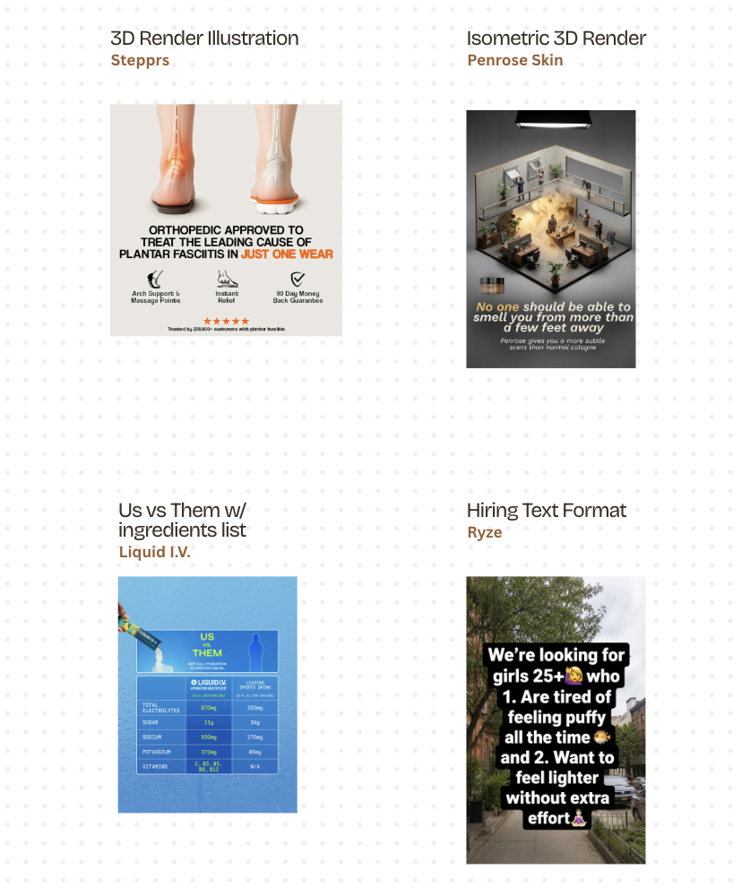

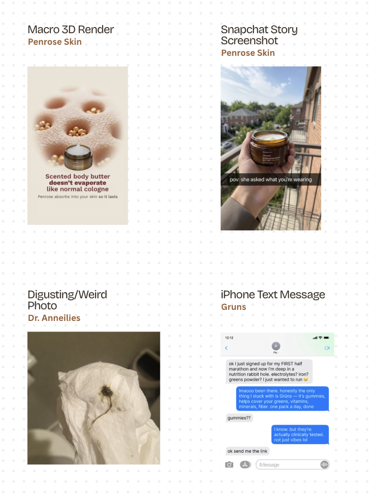

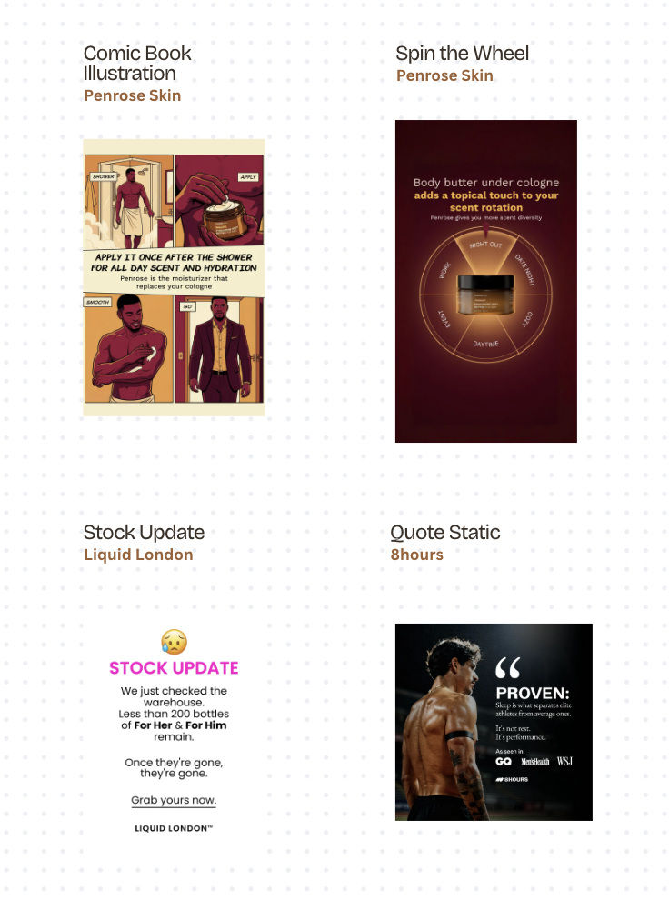

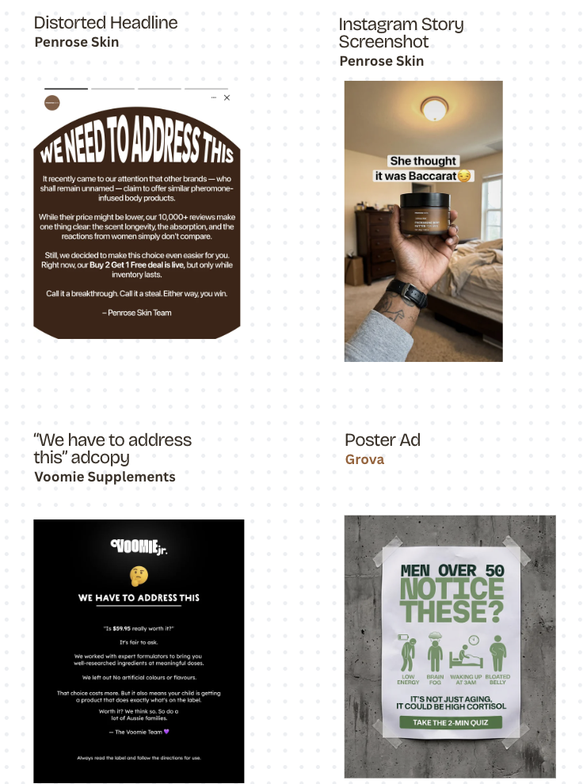

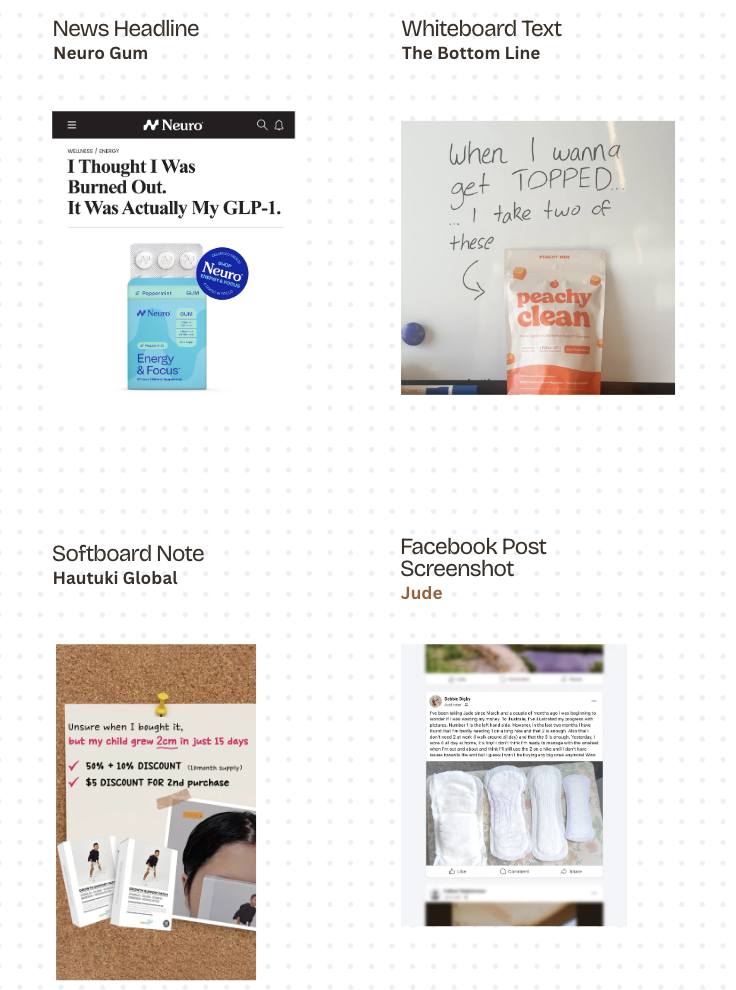

## Set 009 — Forty static reference placements across ten boards
### Source and scope

All ten supplied screenshot files were copied into `assets/static-009/` and checked after copying. Reading order follows attachment order, then top left, top right, bottom left, bottom right. These are 40 placements, including repeated creatives and variants; they are not 40 unique formats. Brand labels below reflect the supplied boards, with uncertainty noted where visible branding differs. Claims and actual performance remain unverified.

### Board 01 — Attention and comparison

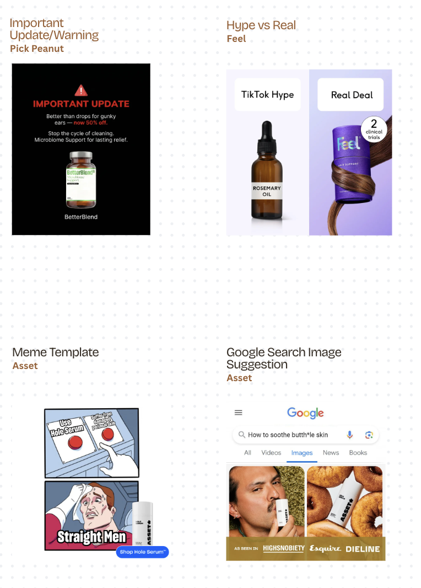

1. **Pick Peanut — Important update.** Black background, red warning heading, short centred copy and isolated bottle. Use announcement hierarchy for a real update; warning styling must not manufacture an emergency.

2. **Feel — Hype versus real.** Two lavender columns compare a familiar alternative with the featured pack, hair imagery and a trial badge. Use aligned visual comparison only with supported differences; the badge is not verified evidence.

3. **Asset — Two-button meme.** A dilemma comic, audience label, product cutout and small CTA turn hesitation into humour. Choose a recognisable audience tension and keep the product readable; adapt humour to the brand.

4. **Asset — Search image results.** A search query leads into a two-image product grid and media-logo strip. Use question-to-answer composition; do not present invented search results or coverage as genuine.

### Board 02 — Context, features and choice

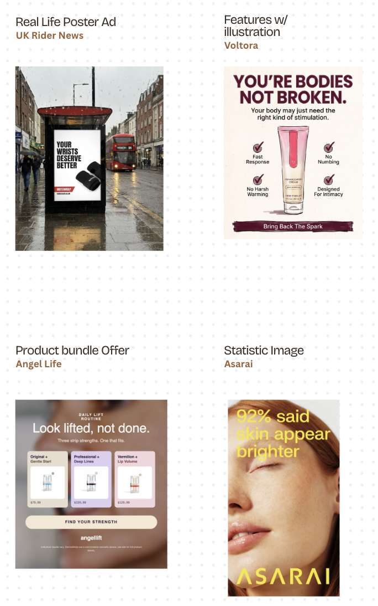

5. **UK Rider News — Street poster.** A bus-shelter poster in a rainy street contains a short wrist-focused headline and product. Use environmental scale and a highly readable core message; a mockup is not proof of a real placement.

6. **Voltora — Illustrated features.** A central tube is flanked by four checkmarked features beneath a reassuring headline. Use balanced callouts and a clear benefit hierarchy. Correct grammar rather than copying the reference headline; source efficacy claims.

7. **Angel Life / angellift — Product options.** Three pastel product cards and prices sit over a soft facial close-up with one selection CTA. Use this for genuine variants and meaningful choice; the board label and visible brand differ, so both are retained.

8. **Asarai — Statistic over portrait.** Large yellow percentage text sits directly over a close facial photograph. One evidence point dominates. Use only a sourced statistic with its population and context; never invent a percentage.

### Board 03 — Personal scenes and visible outcomes

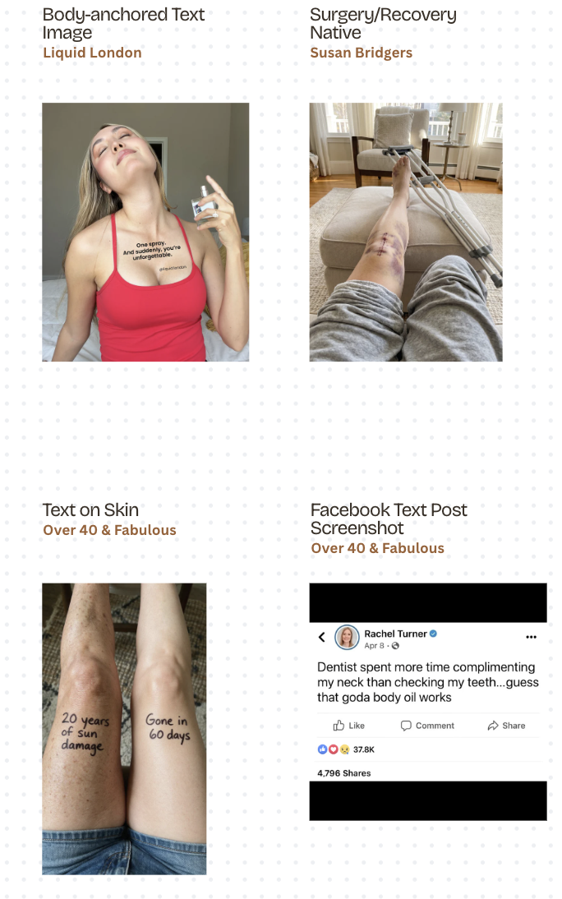

9. **Liquid London — Body-anchored text.** A person holding fragrance has a compact hook positioned on the upper chest. Place copy in a deliberate open area of an image, preserving readability and avoiding implied endorsement without a source.

10. **Susan Bridgers — Recovery photograph.** A first-person view shows a recovering leg, stitches and crutches in a home. Record the candid context, not an inferred treatment result; no visible product establishes what caused recovery.

11. **Over 40 & Fabulous — Text on skin.** A paired-arm comparison uses handwritten time/outcome labels directly on the arms. Borrow integrated labels; do not fabricate a before/after or repeat an unsupported reversal claim.

12. **Over 40 & Fabulous — Facebook text post.** A brief anecdote appears in a familiar post frame with profile and large engagement counts. Borrow concise anecdotal writing only from a real account; identities, verification and counts are not decorative proof.

### Board 04 — Diagrams and contrast

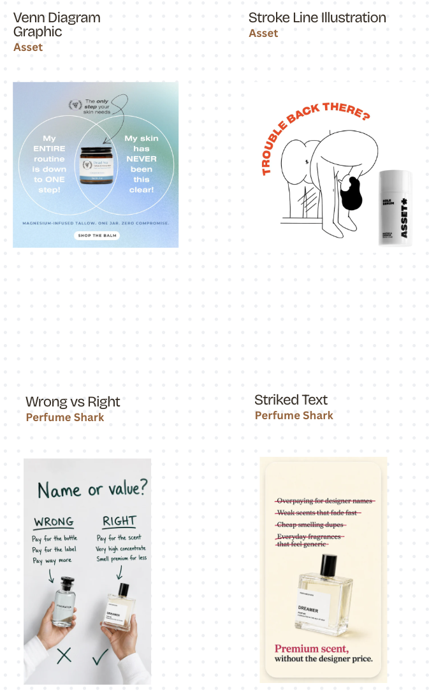

13. **Asset board label — Venn diagram.** White overlapping circles on a blue-green field place a jar at the intersection of simplicity and a desired outcome. Use two complementary benefits and a central solution; exact product attribution is uncertain from this board.

14. **Asset — Line illustration.** A minimal black figure, curved orange question and product pack use white space and an intimate-care concern. Borrow the economical drawing and curved headline. Repeated on board 9; one underlying reference, not two distinct concepts.

15. **Perfume Shark — Wrong versus right.** Handwritten columns, arrows, two hand-held bottles and cross/check symbols compare purchase priorities. Borrow structured tradeoffs; support competitor and formulation statements rather than implying blanket superiority.

16. **Perfume Shark — Crossed-out objections.** A cream card strikes through several frustrations above a bottle and a concise value statement. Use cancellation marks to organise objections, with readable text and a supported resolution.

### Board 05 — Physical props and product range

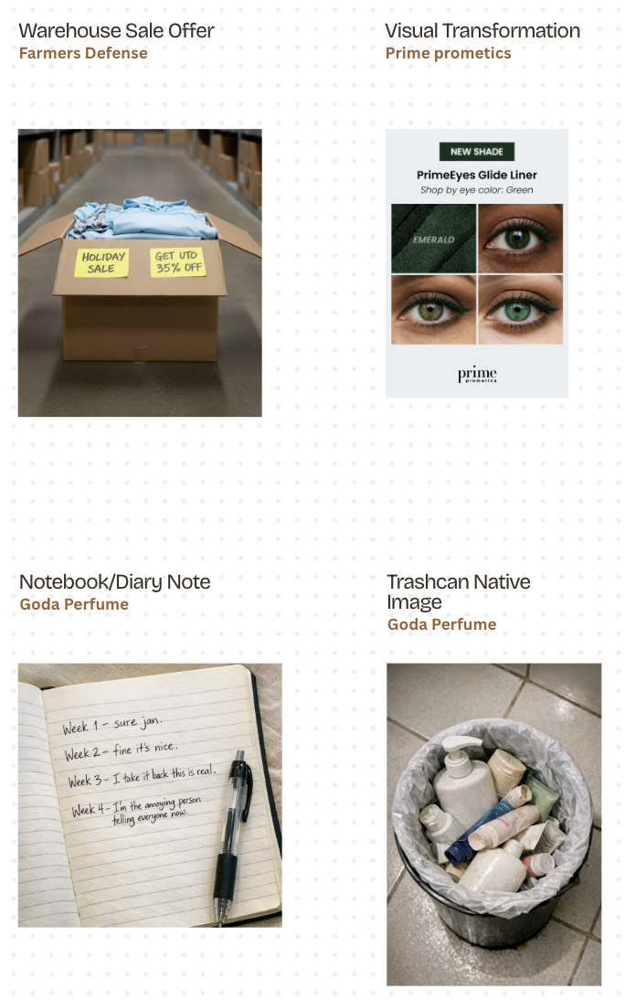

17. **Farmers Defense — Warehouse offer.** An open box of clothes in an aisle carries two yellow offer notes. Use the real fulfilment setting and tactile labels; discounts and warehouse-sale rationale must be accurate.

18. **Prime prometics — Shade demonstration.** A four-cell grid mixes a colour swatch with eye close-ups under a new-shade heading. This visibly demonstrates a shade across images; it is not necessarily a before/after transformation despite the board label.

19. **Goda Perfume — Diary progression.** A lined notebook and pen frame four short entries that move from scepticism to enthusiasm. Borrow the evolving narrative; use genuine experiences or explicitly illustrative brand copy, not a fabricated customer diary.

20. **Goda Perfume — Discarded-product scene.** A wastebasket containing personal-care products acts as a visual replacement metaphor. No readable copy establishes the reason. Avoid inventing an actual customer switching story.

### Board 06 — Peer discussion and staged sequences

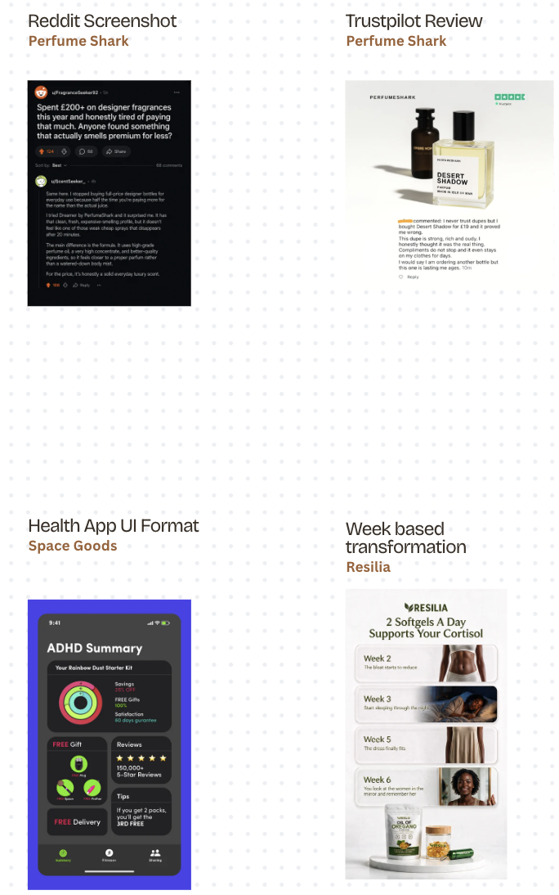

21. **Perfume Shark — Reddit discussion.** A dark question-and-answer thread moves from price frustration to a product recommendation. Borrow objection-led dialogue; real usernames, comments and vote counts require authentic sources.

22. **Perfume Shark — Review with product pair.** A large fragrance image sits above a review excerpt and review-platform branding. Use a real attributed review with enough context; the screenshot alone does not verify its provenance. Reappears on board 8.

23. **Space Goods — Health-app style.** A dark phone dashboard groups offer, gift, review and delivery blocks around colourful activity rings. Borrow modular information grouping; do not imply measured health data or a real app integration.

24. **Resilia — Weekly milestones.** Four rounded rows pair week labels with lifestyle images above product packs. Use a sequence for supported instructions or an actual documented journey; do not invent a timed physiological outcome.

### Board 07 — Decision aids and product assortment

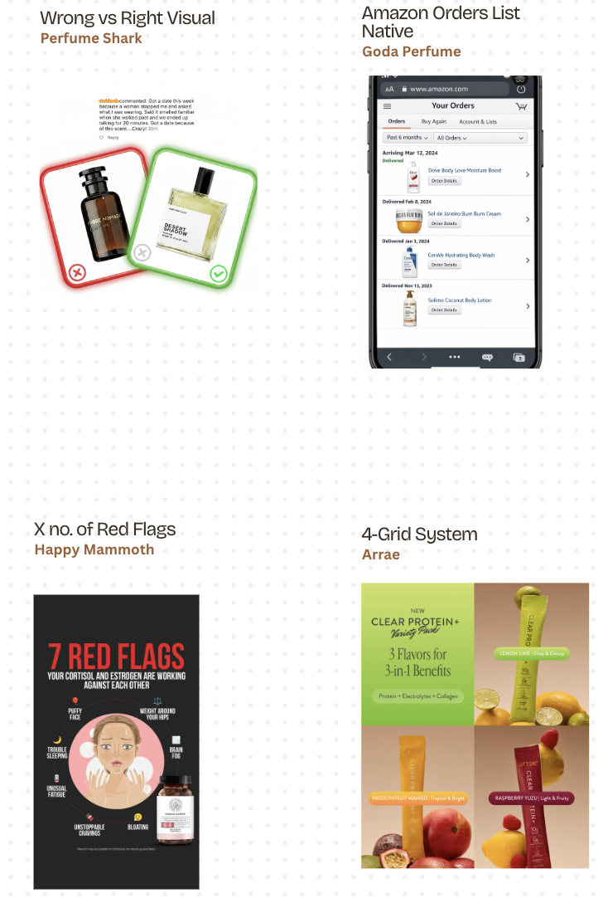

25. **Perfume Shark — Red/green product cards.** Tilted comparison cards, coloured outlines and cross/check marks sit beneath a comment. Borrow quick visual contrast; substantiate the comparison and any testimonial.

26. **Goda Perfume — Order-history phone.** A phone-shaped order list presents several previous purchases. Borrow the idea of fragmented routines when relevant; do not fabricate a customer purchase history or imply access to an account.

27. **Happy Mammoth — Numbered warning signs.** A large red number/title leads into a radial symptom diagram and bottle. Borrow the numbered grouping for supported information; symptoms do not establish a hormonal diagnosis.

28. **Arrae — Four-cell assortment.** One introductory tile and three colourful flavour/product tiles create an orderly 2×2 grid. Use consistent crops, real variants and short labels; this is a strong route when a website has several product options.

### Board 08 — Identity and everyday reflection

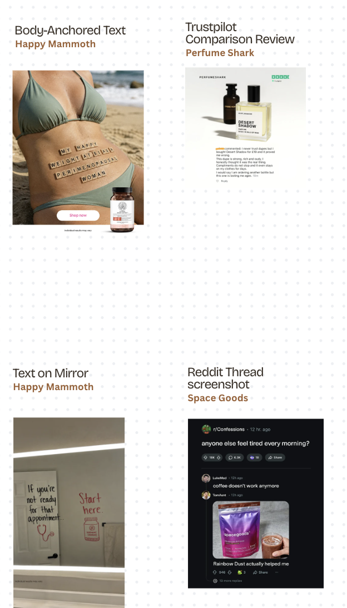

29. **Happy Mammoth — Body-anchored labels.** Small letter-like strips sit on a beach photograph, with product and CTA below. Borrow tactile typography and context; do not infer that the pictured body is a product outcome.

30. **Perfume Shark — Comparison review repeat.** Appears to repeat board 6 review/product creative under a different heading. Preserve this occurrence but group it with board 6 item 2 during selection to avoid overweighting one example.

31. **Happy Mammoth — Mirror writing.** Handwritten text and a small bottle drawing occupy a bathroom mirror. Borrow the familiar moment and practical prop; do not suggest the product replaces a medical appointment.

32. **Space Goods — Reddit thread with image.** A fatigue question and short replies lead to a product-in-hand image. Borrow question → relatable context → useful answer; fabricated community approval and engagement must not become output.

### Board 09 — Reframes and urgency

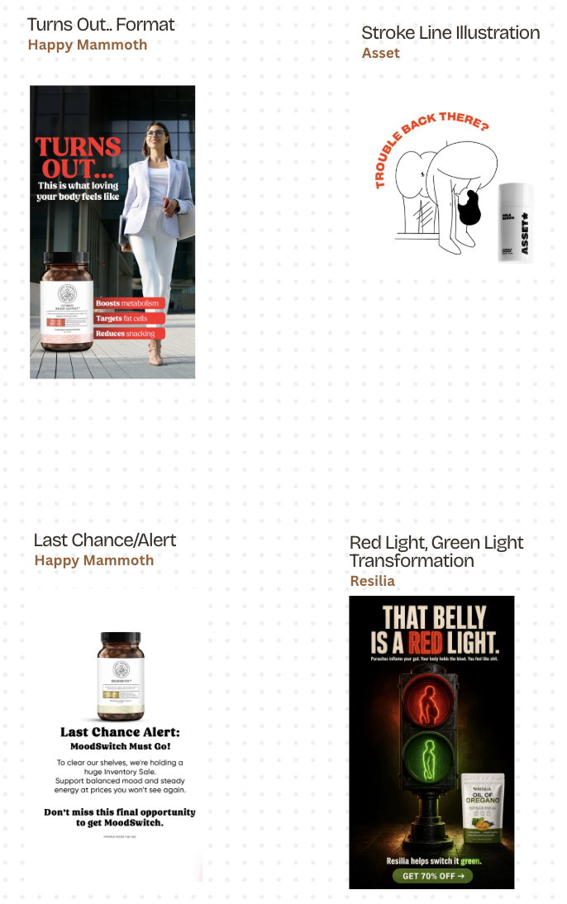

33. **Happy Mammoth — Turns out.** A large red discovery hook overlays a lifestyle photograph, with a bottle and three compact benefit strips. Use a specific supported realisation, not an invented personal transformation.

34. **Asset — Line illustration repeat.** Same curved question, figure and product as board 4 item 2. Keep linked as a repeated reference rather than a new layout.

35. **Happy Mammoth — Last-chance announcement.** A bottle above centred black copy on white makes a product-clearance message. Use only when the sale, availability and reason are real; otherwise choose a non-urgent product announcement.

36. **Resilia — Traffic-light metaphor.** A dramatic red/green signal with body silhouettes sits beside the product and CTA. Borrow a clear state-change metaphor for supported concepts; do not turn body shape into a diagnosis or invent a parasite explanation.

### Board 10 — Large-scale framing and unexpected connections

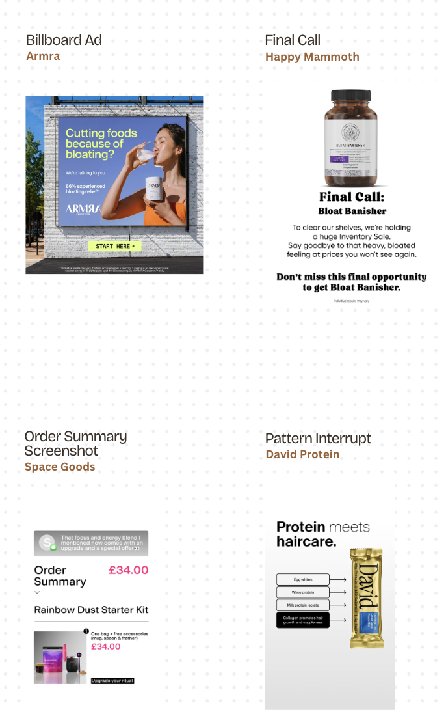

37. **Armra — Billboard scene.** A large outdoor billboard combines a question, person using the product and bright CTA. Borrow the short-distance readability and sense of scale. Placement and percentage claims are unverified.

38. **Happy Mammoth — Final-call variant.** Another bottle-led clearance announcement uses the same sparse structure as board 9 item 3, for a different product. Record as a layout variant; it adds little new composition diversity.

39. **Space Goods — Order summary.** A notification-like strip leads to price, starter-kit contents, product image and upgrade prompt. Use accurate offer breakdowns, not fake purchase confirmations or implied personal messages.

40. **David Protein — Unexpected category connection.** A minimal headline connects protein and haircare; ingredient boxes point to a gold-wrapped bar. Borrow the surprising but explainable connection and labelled arrows. The claimed ingredient-to-hair benefit needs evidence.

### Application to any website

Select by available material: genuine reviews support review formats; real product variants support grids; documented differences support comparisons; an actual offer supports an offer card. When evidence is missing, retain the useful composition and write a brand-authored explanation instead of inventing proof.

Keep visual treatment separate from the claim. Body text, mirrors, notebooks, diagrams and familiar interfaces are ways to arrange information. They do not establish a customer's experience or product efficacy. Preserve the submitted website's identity and adapt copy density to phone viewing. Repeated examples should share a format family so they do not dominate reference selection.

### Reference status

Ten original composite screenshots archived and visually reviewed from chat. Forty placements catalogued, including two apparent repeated creatives and further layout variants. Individual source ads, exact fonts, fine print and evidence for claims were not supplied. Collection now contains 80 static placements across Sets 005–009; this is not a count of unique layouts. Set 008's five original boards have also been restored, archived and verified.

## Set 010 — Eighteen static references across five boards

### Source and scope

Original attachment paths were stale. All five screenshots were found in Desktop/Content Inspiration, opened for visual review, and copied to `assets/static-010/`. Boards 1–4 contain four examples each; board 5 contains two. Reading order is top left, top right, bottom left, bottom right. These are reference placements, not verified high-performing ads.

### Board 01 — Age, reasons and personal accounts

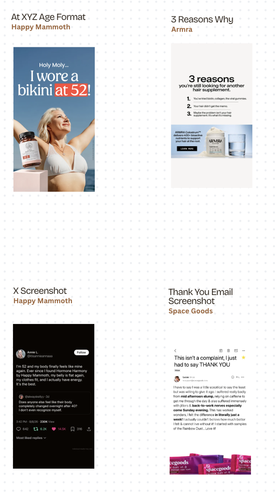

1. **Happy Mammoth — At a specific age.** A blue-sky lifestyle photo supports a large serif personal milestone, with the age highlighted in red and a bottle in the foreground. Borrow specificity and focal emphasis; an age or first-person outcome must belong to a genuine sourced account.

2. **Armra — Three reasons why.** A sparse white layout leads with a numbered three-part explanation, followed by a horizontal product-and-CTA strip. Borrow a short, coherent argument that connects a reader frustration to a supported product distinction.

3. **Happy Mammoth — X post.** A dark social-post frame contains a first-person account and a quoted question about change with age. Borrow problem-response storytelling, not unverified profiles, outcomes or engagement counts.

4. **Space Goods — Thank-you email.** An email-style subject introduces a longer customer narrative, with important phrases emphasised and packs along the bottom. Use an authentic, permitted message; shorten the excerpt for mobile reading and preserve its meaning.

### Board 02 — Price and progress

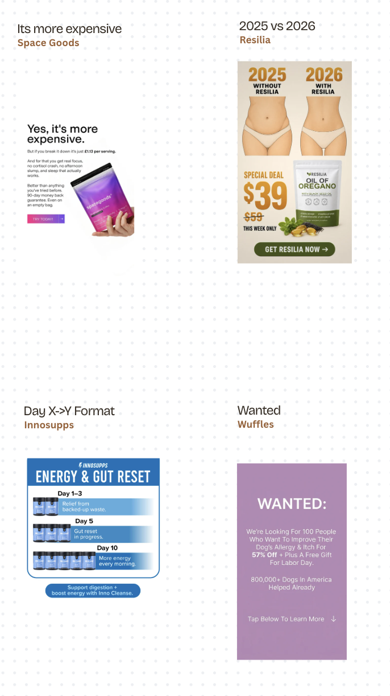

5. **Space Goods — Price acknowledgment.** A direct price-objection headline sits above short explanatory copy, a tilted pack held in a hand and a small colourful CTA. Borrow acknowledgment → cost context → supported value → next step. Per-serving prices and guarantees must be accurate.

6. **Resilia — Year-versus-year comparison.** Two illustrated torsos under year labels lead into an oversized offer and product. Borrow the paired time framing for documented change; do not manufacture body transformations or date-limited offers.

7. **Innosupps — Day-by-day rows.** Three blue horizontal stages pair product images with day labels and outcomes. Use this orderly progression for supported steps or instructions; do not invent a biological timetable.

8. **Wuffies — Wanted notice.** A lavender field contains a large wanted heading, audience invitation, offer and downward prompt. Borrow text-led recruitment to a genuine offer; customer totals, participant limits and discounts need sources. Board label appears as Wuffles; visible packs elsewhere read Wuffies.

### Board 03 — Answers, aspiration and packaging

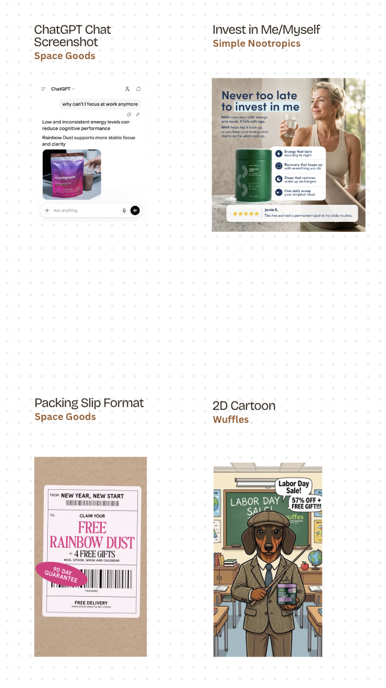

9. **Space Goods — ChatGPT-style answer.** A question and answer in a familiar AI chat interface lead into a product photo. Borrow question → explanation → relevant product, preferably as a clearly brand-authored Q&A. Do not imply an independent AI endorsement or a real response without evidence.

10. **Simple Nootropics — Invest in myself.** A lifestyle portrait, large green pack, four benefit callouts and a review strip support an aspirational headline. Borrow self-investment framing and layered hierarchy; source the benefit and review statements.

11. **Space Goods — Packing slip.** A pink shipping-label composition on cardboard combines a bold offer, barcode-like decoration, gift details and a guarantee sticker. Borrow the physical label structure; make offer conditions clear and avoid suggesting an actual order or shipment.

12. **Wuffies — Cartoon character.** A detective-like dog in a classroom holds the pack while speech bubbles announce an offer. Borrow a distinctive character, coherent setting and clear product focus. This is an illustration, not an expert endorsement; use original or authorised artwork.

### Board 04 — Participation, timeline and conversation

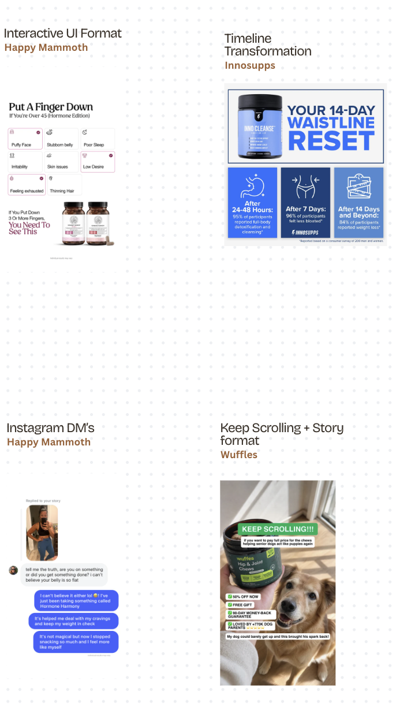

13. **Happy Mammoth — Put a finger down.** A headline invites participation above a grid of symptom cards and product imagery. Borrow the checklist interaction idea for a static post. It is not functional UI or a diagnostic tool; avoid implying a symptom count establishes a condition.

14. **Innosupps — Three-stage timeline.** A large product/headline block sits over three blue tiles with icons, timings and percentages. Borrow consistent stages and visual hierarchy; any survey percentages need a source and context. Do not infer efficacy from this reference.

15. **Happy Mammoth — Instagram DMs.** A story image introduces alternating message bubbles that move from a question to a personal recommendation. Use a genuine permissioned exchange or a clearly illustrative brand conversation, without inventing a customer result.

16. **Wuffies — Keep scrolling story.** A hand-held jar and dog photograph carry a reverse-psychology hook plus stacked offer/proof labels. Borrow a brief playful hook and relevant everyday image; reduce competing labels for readability and verify all offers and proof.

### Board 05 — Comments and newsletter

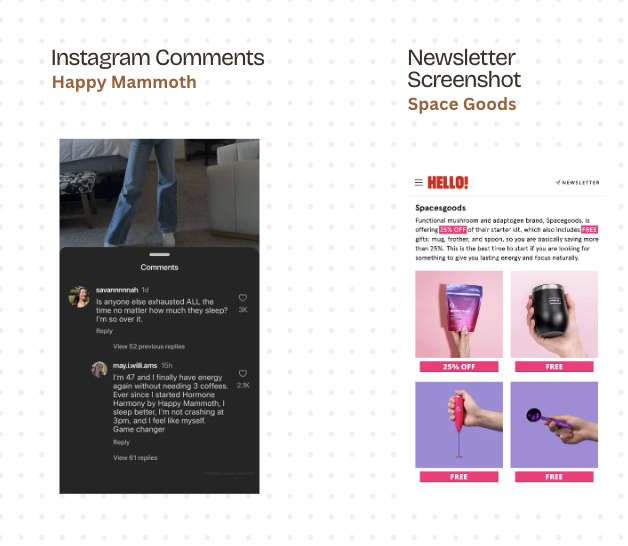

17. **Happy Mammoth — Instagram comments.** A cropped lifestyle image leads into a dark comment panel with a relatable complaint and reply. Borrow objection-response structure; comments, likes, identities and endorsements must not be fabricated.

18. **Space Goods — Newsletter.** An editorial masthead and short paragraph introduce a four-cell product/gift grid with vivid offer labels. Borrow article-to-assortment hierarchy. Do not imply third-party coverage or permission to use a publisher masthead without evidence; use the brand identity by default.

### Reusable writing and layout lessons

Acknowledge a concrete hesitation before explaining value. Use numbered reasons when the website supplies a clear argument; use steps when it supplies a process; use a product grid when it supplies meaningful variants or bundle contents. Match the format to the evidence available, not merely to a visually appealing example.

Email, chat, comments and newsletter frames are presentation choices, not independent proof. Preserve real attribution when available; otherwise use clearly brand-authored copy. Select the website's colours, fonts, imagery and voice rather than carrying wellness branding into every output. Keep final feed text readable and avoid repeating near-identical testimonial layouts simply because the collection contains many of them.

### Reference status

All five original composite screenshots archived, opened for review and verified byte-for-byte against their sources. Eighteen placements recorded. The static collection now contains 98 placements across Sets 005–010, including duplicates and related variants; this is not 98 unique formats. Exact fonts, full-resolution individual ads, claims and performance remain unverified.
